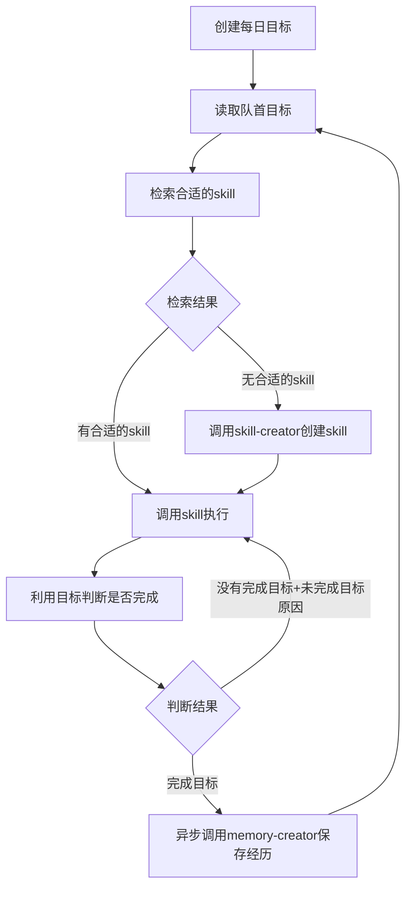
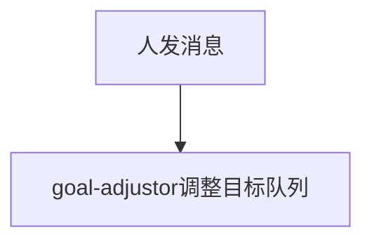

# 处理流程

## 主流程



## 打断流程



## 创建每日目标

### context
```markdown
1. 昨日记忆 （待定）
2. 创建目标skill
```

### effect

目标队列
```markdown
target1, target2, ...
```

日志
```json
{"type":"create targets", "content":"[]"}
```

### 检索合适的skill

### context
```markdown
1. 检索模版
2. 当前目标
```


